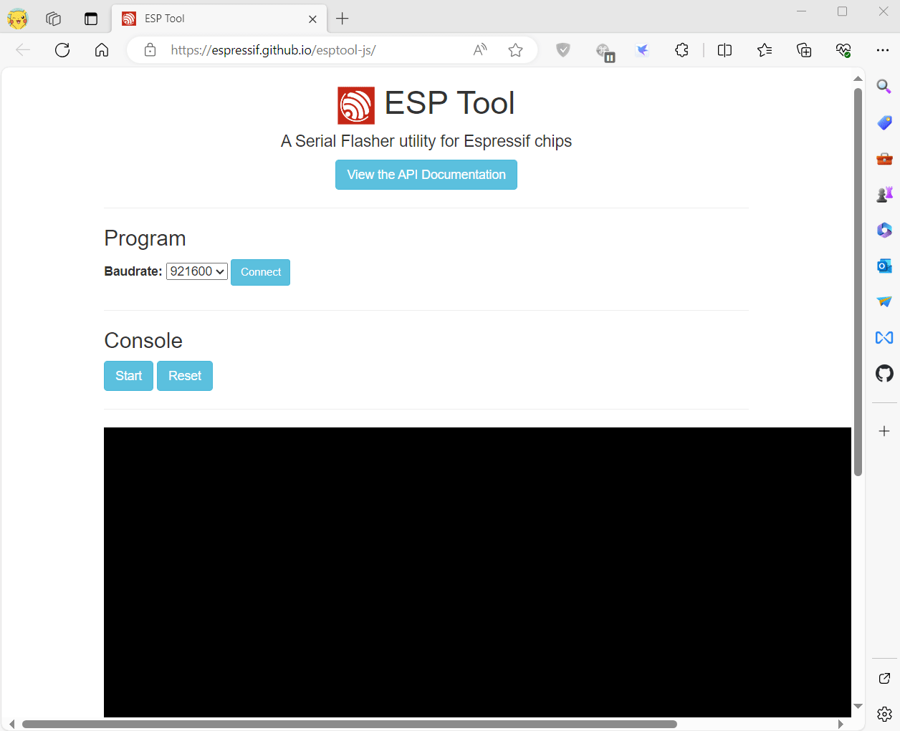

<div align="center" markdown="1">
  
</div>

<h1 align = "center">🌟LilyGo Firmware🌟</h1>

# [中文](README_CN.MD) 


> \[!IMPORTANT]
>
> - How do I prove to LilyGo that the board is broken?
> 1. You need to shoot a video to prove that the board is broken. Please follow the steps below to shoot a video to prove that the board is broken.
> 2. Follow the steps at the bottom of this page to put the board into download mode.
> 3. Select the burning tool, download the corresponding firmware, and upload the firmware to the board through the burning tool.
> 4. After the burning is complete, press the RST key, or disconnect the USB connection and reinsert it. If the board has a battery, you must power it off and restart to exit download mode.
> 5. Plug in the USB, open the serial port, and record the contents of the serial monitor.
> 6. Any of the above steps must be included in the video content to facilitate explanation.
>

## Where can I find the factory firmware?

* [Older firmware version with a white background](https://github.com/Xinyuan-LilyGO/LilyGoLib/releases/tag/V0.2.1)
* New black UI on the current page.

## 1️⃣Support Product


> [!TIP]
>
> The T-Vibe-Pager comes with the T-LoRa-Pager firmware installed by default; therefore, to restore it to its factory state, you must flash the T-LoRa-Pager firmware.
>
> The T-Vibe-Dev comes with the T-Deck firmware installed by default; therefore, to restore it to its factory state, you must flash the T-Deck firmware.
>

| Product                            | Factory firmware                         |
| ---------------------------------- | ---------------------------------------- |
| [T-LoRa-Pager SX1262 version][1]   | tlora-pager-sx1262-factory-xxxx-0x0.bin  |
| [T-LoRa-Pager LR1121 version][1]   | tlora-pager-lr1121-factory-xxxx-0x0.bin  |
| [T-Vibe-Pager][1]                  | tlora-pager-sx1262-factory-xxxx-0x0.bin  |
| [T-Watch-Ultra SX1280  version][2] | twatch-ultra-sx1280-factory-xxxx-0x0.bin |
| [T-Watch-Ultra SX1262 version][2]  | twatch-ultra-sx1262-factory-xxxx-0x0.bin |
| [T-Watch-S3 SX1262 version][3]     | twatchs3-sx1262-factory-xxxx-0x0.bin     |
| [T-Watch-S3 SX1280 version][3]     | twatchs3-sx1280-factory-xxxx-0x0.bin     |
| [T-Watch-S3 CC1101][3]             | twatchs3-cc1101-factory-xxxx-0x0.bin     |
| [T-Watch-S3-Plus][4]               | Same T-Watch-S3 firmware                 |
| [T-Deck or T-Vibe-Dev][5]          | tdeck-sx1262-factory-xxxx-0x0.bin        |
| [T-Deck-Plus][6]                   | tdeck-sx1262-factory-xxxx-0x0.bin        |
| [T-Vibe-Dev][5]                    | tdeck-sx1262-factory-xxxx-0x0.bin        |
| [T-Watch-2020-V3][7]               | q307-twatch2020v3-factory-xxxx-0x0.bin   |
| [T-Watch-2019][8]                  | twatch-2019-factory-xxxx-0x0.bin         |

[1]: https://lilygo.cc/products/t-lora-pager
[2]: https://lilygo.cc/products/t-watch-ultra
[3]: https://lilygo.cc/products/t-watch-s3
[4]: https://lilygo.cc/products/t-watch-s3-plus
[5]: https://lilygo.cc/products/t-deck
[6]: https://lilygo.cc/products/t-deck-plus
[7]: https://lilygo.cc/products/t-watch-2020-v3
[8]: https://lilygo.cc/products

## 2️⃣How to Flash ?

> \[!IMPORTANT]
>
> 🤖 USB port keeps appearing intermittently?
>
> ⚠️ When writing firmware, please put the device into download mode first in order to download the firmware normally.
>
> * [How to put T-Deck or T-Vibe-Dev into download mode](../docs/lilygo-t-deck.md#entering-download-mode-on-the-t-deck)
> * [How to put T-Watch-S3 into download mode](../docs/lilygo-t-watch-s3.md#entering-download-mode-on-the-t-watch-s3)
> * [How to put T-Watch-S3-Plus into download mode](../docs/lilygo-t-watch-s3-plus.md#entering-download-mode-on-the-t-watch-s3-plus)
> * [How to put T-Watch-Ultra into download mode](../docs/lilygo-t-watch-ultra.md#entering-download-mode-on-the-t-watch-ultra)
> * [How to put T-LoRa-Pager or T-Vibe-Pager into download mode](../docs/lilygo-t-lora-pager.md#entering-download-mode-on-the-t-lora-pager)
>
> ⚠️ After the download is complete, you must press the reset button once; otherwise, the device will remain in download mode.
>
> ⚠️ The write address must be 0, not the default 0x1000.
>
> ⚠️Choose one of the following methods that suits you.
>

## LILYGO Spark

- [LILYGO Spark](https://lilygo.cc/pages/lilygo-spark)


## ESP-Launchpad Online

- [Esp-launchpad](https://espressif.github.io/esp-launchpad/)


### Use ESP Download Tool

- Download [Flash_download_tool](https://dl.espressif.com/public/flash_download_tool.zip)


* Note that after writing is completed, you need to press RST to reset.
* T-Watch-S3 does not have a reset button, you must power off and restart to start, otherwise it will always be in download mode

### Use Web Flasher

- [ESP Web Flasher Online](https://espressif.github.io/esptool-js/)



* Note that after writing is completed, you need to press RST to reset.
* T-Watch-S3 does not have a reset button, you must power off and restart to start, otherwise it will always be in download mode

### Use command line


If system asks about install Developer Tools, do it.

```bash
python3 -m pip install --upgrade pip
python3 -m pip install esptool
```

In order to launch esptool.py, exec directly with this:

```bash
python3 -m esptool
```

For ESP32-S3 use the following command to write

```bash
esptool --chip esp32s3  --baud 921600 --before default_reset --after hard_reset write_flash -z --flash_mode dio --flash_freq 80m 0x0 firmware.bin

```

# How to view the device serial boot log


