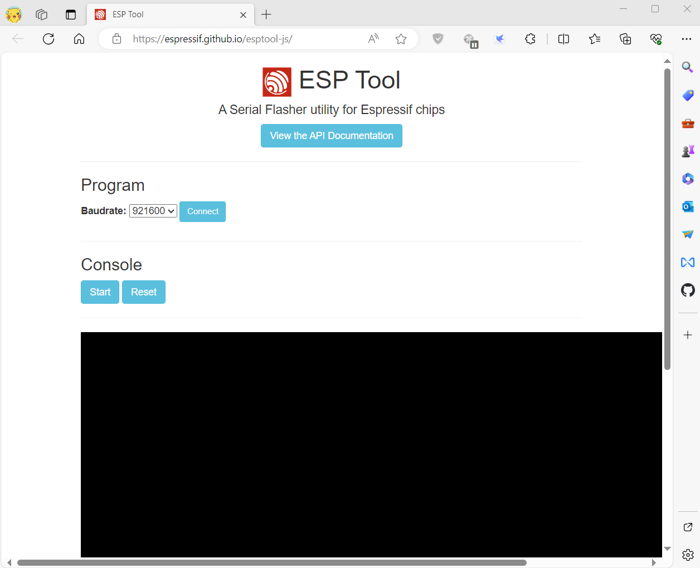

<div align="center" markdown="1">
  
</div>

<h1 align = "center">🌟LilyGo 固件🌟</h1>

# [English](./README.md)

> \[!IMPORTANT]
>
> - 如何向 LilyGo 证明开发板出现故障？
> 1. 请拍摄视频，记录以下操作及故障现象，以便证明开发板出现故障.
> 2. 按照本页下方的步骤，让开发板进入下载模式.
> 3. 选择烧录工具，下载对应的固件，并使用烧录工具将固件写入开发板.
> 4. 烧录完成后，确认开发板重新启动. 如果未自动重启，请按 RST 或关机后重新开机. T-Watch-S3 没有复位按钮，如果仍停留在下载模式，需要关机后重新开机.
> 5. 连接 USB，打开串口，并录下串口监视器显示的内容.
> 6. 请在视频中完整记录上述操作，以便说明问题.
>

## 在哪里可以找到出厂固件？

* [采用白色背景的旧版固件](https://github.com/Xinyuan-LilyGO/LilyGoLib/releases/tag/V0.2.1)
* 当前页面提供采用黑色界面的新版固件.

## 1️⃣ 支持的产品

> [!TIP]
>
> 在线写入器中请选择 T-Vibe-Pager 条目，使用下表列出的专用固件.
> 
> 要将 T-Vibe-Dev 恢复到出厂状态，请烧录专用的 T-Vibe-Dev 固件.
>

| 产品                          | 出厂固件                                 |
| ----------------------------- | ---------------------------------------- |
| [T-LoRa-Pager SX1262版本][1]  | tlora-pager-sx1262-factory-xxxx-0x0.bin  |
| [T-LoRa-Pager LR1121版本][1]  | tlora-pager-lr1121-factory-xxxx-0x0.bin  |
| [T-Vibe-Pager][1]             | tvibe-pager-factory-xxxx-0x0.bin         |
| [T-Watch-Ultra SX1280版本][2] | twatch-ultra-sx1280-factory-xxxx-0x0.bin |
| [T-Watch-Ultra SX1262版本][2] | twatch-ultra-sx1262-factory-xxxx-0x0.bin |
| [T-Watch-S3 SX1262版本][3]    | twatchs3-sx1262-factory-xxxx-0x0.bin     |
| [T-Watch-S3 SX1280版本][3]    | twatchs3-sx1280-factory-xxxx-0x0.bin     |
| [T-Watch-S3 CC1101][3]        | twatchs3-cc1101-factory-xxxx-0x0.bin     |
| [T-Watch-S3-Plus][4]          | 写T-Watch-S3固件                         |
| [T-Deck][5]                   | tdeck-sx1262-factory-xxxx-0x0.bin        |
| [T-Deck-Plus][6]              | tdeck-sx1262-factory-xxxx-0x0.bin        |
| [T-Vibe-Dev][5]               | tvibe-dev-factory-xxxx-0x0.bin           |
| [T-Watch-2020-V3][7]          | q307-twatch2020v3-factory-xxxx-0x0.bin   |
| [T-Watch-2019][8]             | twatch-2019-factory-xxxx-0x0.bin         |
| [T-Embed-Plus][9]             | tembed-plus-factory-xxxx-0x0.bin         |
| [T-Embed-Plus V2](../docs/lilygo-t-embed-plus-v2.md) | tembed-plus-v2-factory-xxxx-0x0.bin |
| [T-Embed](../docs/lilygo-t-embed.md) | tembed-factory-xxxx-0x0.bin |

[1]: https://lilygo.cc/products/t-lora-pager
[2]: https://lilygo.cc/products/t-watch-ultra
[3]: https://lilygo.cc/products/t-watch-s3
[4]: https://lilygo.cc/products/t-watch-s3-plus
[5]: https://lilygo.cc/products/t-deck
[6]: https://lilygo.cc/products/t-deck-plus
[7]: https://lilygo.cc/products/t-watch-2020-v3
[8]: https://lilygo.cc/products
[9]: https://lilygo.cc/products/t-embed-cc1101-plus

## 2️⃣ 如何烧录固件？

> \[!IMPORTANT]
>
> 🤖 USB 端口是否反复出现又消失？
>
> ⚠️ 烧录固件前，请先让设备进入下载模式，以便正常写入固件.
>
> * [让 T-Deck 或 T-Vibe-Dev 进入下载模式](../docs/lilygo-t-deck.md#entering-download-mode-on-the-t-deck)
> * [让 T-Watch-S3 进入下载模式](../docs/lilygo-t-watch-s3.md#entering-download-mode-on-the-t-watch-s3)
> * [让 T-Watch-S3-Plus 进入下载模式](../docs/lilygo-t-watch-s3-plus.md#entering-download-mode-on-the-t-watch-s3-plus)
> * [让 T-Watch-Ultra 进入下载模式](../docs/lilygo-t-watch-ultra.md#entering-download-mode-on-the-t-watch-ultra)
> * [让 T-LoRa-Pager 或 T-Vibe-Pager 进入下载模式](../docs/lilygo-t-lora-pager.md#entering-download-mode-on-the-t-lora-pager)
> * [让 T-Embed-Plus 进入下载模式](../docs/lilygo-t-embed-plus.md#3-entering-download-mode-on-the-t-embed-plus)
> * [让 T-Embed-Plus V2 进入下载模式](../docs/lilygo-t-embed-plus-v2.md#3-entering-download-mode-on-the-t-embed-plus-v2)
> * [让 T-Embed 进入下载模式](../docs/lilygo-t-embed.md#3-entering-download-mode-on-the-t-embed)

> 烧录后请确认设备重新启动. 如果仍停留在下载模式，请按 RST；T-Watch-S3 需要关机后重新开机.
>
> ⚠️ 烧录地址必须是 0，不能使用默认的 0x1000.
>
> ⚠️ 请选择以下一种适合自己的烧录方式.
>

## LilyGo Flash Lab

**[打开在线写入器](https://xinyuan-lilygo.github.io/LilyGoLib/web-flasher/)**

使用桌面版 Chrome 或 Edge，并保持联网. HTTPS 页面支持中文、English 和日本語，可按设备和射频版本选择已发布的出厂固件，无需额外安装烧录软件或 Python. 当前页面不支持手机和平板浏览器的 USB 烧录.

1. 用 USB 数据线将开发板连接到打开浏览器的电脑.
2. 选择与硬件一致的设备及射频版本. T-Embed-Plus 和 T-Embed-Plus V2 必须使用各自的固件.
3. 按页面中的设备专属下载模式指南操作，然后点击“连接设备”，在浏览器弹出的列表中选择对应串口.
4. 核对所选固件后点击“开始写入固件”. 页面自动使用地址 `0x0`，写入进度会悬浮在顶部. 写入结束前请保持 USB 连接.
5. 页面会尝试自动复位，释放串口后弹出完成提示. 如果设备没有重启，请按 RST/RESET；T-Watch-S3 需要关机后重新开机. 点击“确认”关闭弹窗.

写入会覆盖镜像对应的 Flash 区域，可能包含设置及文件系统数据，请先备份需要保留的内容. 如需选择自定义 `.bin`，请使用适用于所选设备、包含引导程序和分区表的合并镜像，不能使用单独的应用 `.bin`.

如果串口列表中没有设备，请检查 USB 数据线、重新进入下载模式，并确认已安装开发板所需的 USB 转串口驱动. 连接或写入失败的原因可在页面操作日志中查看.

## LILYGO Spark

- [LILYGO Spark](https://lilygo.cc/pages/lilygo-spark)


## ESP-Launchpad 在线烧录

- [ESP-Launchpad](https://espressif.github.io/esp-launchpad/)


### 使用 ESP Download Tool

- 下载 [Flash_download_tool](https://dl.espressif.com/public/flash_download_tool.zip)


* 烧录完成后，请按 RST 按钮复位设备.
* T-Watch-S3 没有复位按钮，必须关机后重新启动，否则设备会一直停留在下载模式.

### 使用网页烧录工具

- [ESP Web Flasher 在线烧录工具](https://espressif.github.io/esptool-js/)



* 烧录完成后，请按 RST 按钮复位设备.
* T-Watch-S3 没有复位按钮，必须关机后重新启动，否则设备会一直停留在下载模式.

### 使用命令行

如果系统提示安装开发者工具，请按提示安装.

```bash
python3 -m pip install --upgrade pip
python3 -m pip install esptool
```

可直接运行以下命令启动 esptool.py：

```bash
python3 -m esptool
```

使用以下命令烧录固件：

```bash
esptool --port /dev/tty.usbmodexxxx --baud 115200 write-flash 0x0 firmware.bin
```

# 如何查看设备的串口启动日志


